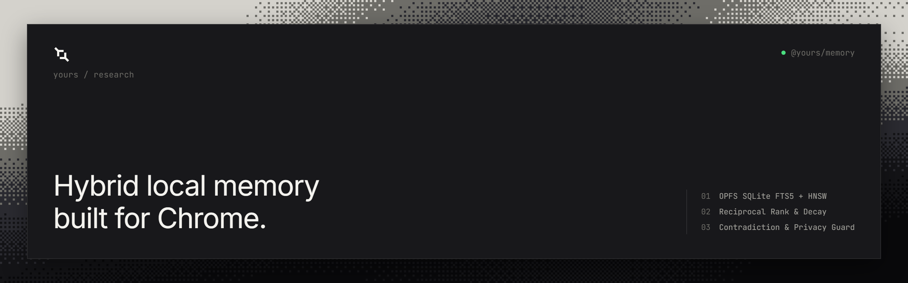
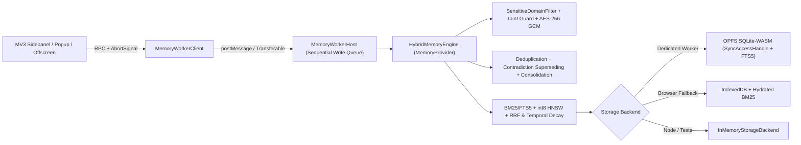

<p align="center">
  <a href="https://yours.sh">
    <picture>
      <source media="(prefers-color-scheme: dark)" srcset="https://raw.githubusercontent.com/yours-research/yours-memory/main/assets/hero-dark.png" />
      <source media="(prefers-color-scheme: light)" srcset="https://raw.githubusercontent.com/yours-research/yours-memory/main/assets/hero-light.png" />
      
    </picture>
  </a>
</p>

<p align="center">
  <a href="https://yours.sh">yours.sh</a> ·
  <a href="https://github.com/yours-research">GitHub Org</a> ·
  <a href="https://huggingface.co/yours-research">Hugging Face</a> ·
  <a href="https://x.com/yoursdotsh">X (@yoursdotsh)</a>
</p>

# `@yours/memory`

**100% local, privacy-first hybrid memory engine** built for **Chrome Manifest V3 extensions** and **local web AI apps**. Runs inside a **Dedicated Web Worker** over **OPFS SQLite-WASM (`SyncAccessHandle` VFS) + FTS5 + `int8`-quantized HNSW vector indexing**, with transparent **IndexedDB** and **In-Memory** fallbacks.

- **Zero external network requests** — all indexing, ranking, consolidation, and AES-256-GCM encryption happen strictly on-device.
- **Four memory tiers** — `working` (ephemeral tab/goal graph), `profile` (durable user preferences & facts), `episodic` (consolidated session summaries), and `document` (opt-in indexed web pages/PDF chunks).
- **Hybrid Retrieval (BM25 + Quantized HNSW + RRF)** — FTS5/BM25 lexical search fused with `int8`-quantized HNSW ANN vector search via Reciprocal Rank Fusion (`RRF`) and tier-aware temporal salience decay.
- **Non-Destructive Contradiction Handling** — preference updates supersede older facts (`supersededById` + `memory_edges` provenance graph) instead of silently overwriting history.
- **Privacy & IDPI Taint Guard** — built-in sensitive-domain blocklist (`chrome://`, banking, auth/SSO, password managers, localhost secrets), taint propagation blocking untrusted page overrides of user profile facts, and WebCrypto PBKDF2 + AES-256-GCM encrypted export/import.

---

## Architecture



---

## Installation

```bash
npm install @yours/memory
```

---

## Quickstart

### 1. Direct Engine Usage (Web / Extension / Node)

```ts
import { HybridMemoryEngine } from '@yours/memory';

const memory = new HybridMemoryEngine({
  quantization: 'int8', // 4x smaller vector storage & RAM footprint
});
await memory.init();

// Store a durable user preference
const pref = await memory.remember({
  tier: 'profile',
  content: 'My favorite editor is Vim',
  tags: ['tools', 'editor'],
  importance: 0.9,
});

// Later preference update supersedes non-destructively (keeps provenance chain)
const updated = await memory.remember({
  tier: 'profile',
  content: 'My favorite editor is VS Code',
});
console.log(updated.supersedesId === pref.id); // true

// Hybrid BM25 + int8 HNSW + RRF + temporal salience recall
const hits = await memory.recall({
  query: 'preferred code editor',
  tiers: ['profile', 'episodic'],
  limit: 5,
});

// Encrypted local backup & wipe
const backup = await memory.exportEncrypted('strong-local-passphrase');
await memory.wipeAll();
await memory.importEncrypted(backup, 'strong-local-passphrase');
```

### 2. Chrome Manifest V3 Dedicated Web Worker Setup

In Chrome Manifest V3, **Service Workers cannot access `FileSystemFileHandle.createSyncAccessHandle()`** and suspend after ~30 seconds of idle time. Host `@yours/memory` inside a **Dedicated Web Worker** launched from an **Offscreen Document**, **Sidepanel**, or **Extension Page** so a single worker owns the OPFS SQLite-WASM handle without multi-writer lock contention.

**`memory-worker.ts` (Dedicated Web Worker):**

```ts
import {
  adaptSqliteWasmDb,
  HybridMemoryEngine,
  OpfsSqliteStorageBackend,
  startMemoryWorkerHost,
  WebGpuEmbedderAdapter,
} from '@yours/memory';
// Optional: bundle @sqlite.org/sqlite-wasm locally in your extension package
import sqlite3InitModule from '@sqlite.org/sqlite-wasm';

const storage = new OpfsSqliteStorageBackend({
  opfsDirectory: await navigator.storage.getDirectory(),
  openDb: async () => {
    const sqlite3 = await sqlite3InitModule();
    const db = new sqlite3.oo1.OpfsDb('/yours-memory.sqlite3');
    return adaptSqliteWasmDb(db);
  },
});

const engine = new HybridMemoryEngine({
  storage,
  quantization: 'int8',
  // Optional: plug in a local WebGPU / Transformers.js embedder
  // embedder: new WebGpuEmbedderAdapter({ dimensions: 384, embedBatch: ... }),
});

await startMemoryWorkerHost(engine);
```

**`sidepanel.ts` / `offscreen.ts` (RPC Client):**

```ts
import { createMv3WorkerClient } from '@yours/memory/worker';

const memory = createMv3WorkerClient(chrome.runtime.getURL('memory-worker.js'), {
  timeoutMs: 15_000,
});

const controller = new AbortController();
const hits = await memory.recall({ query: 'WebGPU compute shader notes', limit: 5 }, controller.signal);
```

> **Note:** If OPFS `SyncAccessHandle` or SQLite-WASM is unavailable (e.g., private browsing or plain browser tabs), `createBestStorageBackend()` automatically falls back to `IndexedDbStorageBackend`, and in Node/Vitest to `InMemoryStorageBackend`.

---

## API Reference

### `MemoryProvider` (`docs/ECOSYSTEM_CONTRACTS.md`)

- `remember(input, options?)` — Validates `sourceUrl` against `SensitiveDomainFilter`, computes embeddings, deduplicates near-identical memories, checks contradictions & taint policy, persists record + quantized vector + HNSW index.
- `recall(query)` — Runs lexical (`FTS5`/`BM25`) + semantic (`int8`/`f32` HNSW) retrieval, merges via Reciprocal Rank Fusion (`RRF`), applies per-tier temporal salience decay + importance + access reinforcement.
- `consolidate(threadId, messages)` — Extracts durable `profile` facts strictly from untainted `'user'` messages and produces an `episodic` session summary with provenance edges.
- `inspect(filter?)` — Lists stored records (`tier`, `limit`, `offset`, `includeSuperseded`, `threadId`, `tainted`).
- `inspectGraph(recordId)` — Returns `MemoryProvenanceNode` (`record`, `edges`, `supersedes`, `supersededBy`).
- `forget(id)` — Deletes a record, its vector, HNSW node, and connected edges.
- `exportEncrypted(passphrase)` / `importEncrypted(blob, passphrase)` — PBKDF2-SHA256 (210,000 iterations) + AES-256-GCM authenticated backup envelope (`YMEM` v1).
- `wipeAll()` — Clears all memories, vectors, edges, HNSW snapshots, and custom blocklist rules.

### Privacy & Domain Controls

- `addBlockedDomain(pattern, kind?, reason?)` — Add `'glob'`, `'regex'`, or `'exact'` capture exclusions.
- `removeBlockedDomain(id)` — Remove a user-configured rule (built-in safety rules cannot be removed).
- `listBlockedDomains()` / `isUrlBlocked(url)` — Inspect active privacy rules and test URLs before capture.

---

## Ecosystem

| Package | Role |
| --- | --- |
| [`yours-tools`](https://github.com/yours-research/yours-tools) | Canonical browser/agent tool schemas & safety hints |
| [`yours-harness`](https://github.com/yours-research/yours-harness) | Pluggable local LLM runtime & streaming adapter |
| **`yours-memory`** | **Local OPFS SQLite + FTS5 + quantized HNSW hybrid memory** |
| [`yours-models`](https://github.com/yours-research/yours-models) | Verified model manifests, chunk hashing & WebGPU hardware prober |
| [`yours-guard`](https://github.com/yours-research/yours-guard) | IDPI spotlighting, prompt injection guard & policy verdict engine |
| [`yours-voice`](https://github.com/yours-research/yours-voice) | Local speech-to-text, VAD & TTS pipeline |
| [`yours-evals`](https://github.com/yours-research/yours-evals) | Cross-stack deterministic evaluation scorecards |
| [`yours-browser-extension`](https://github.com/yours-research/yours-browser-extension) | Chromium MV3 local AI browser agent |

---

## Development

```bash
npm install
npm run typecheck
npm run build
npm test
```

<p align="center">
  <sub>yours / research · Making local inference for everyone.</sub>
</p>
